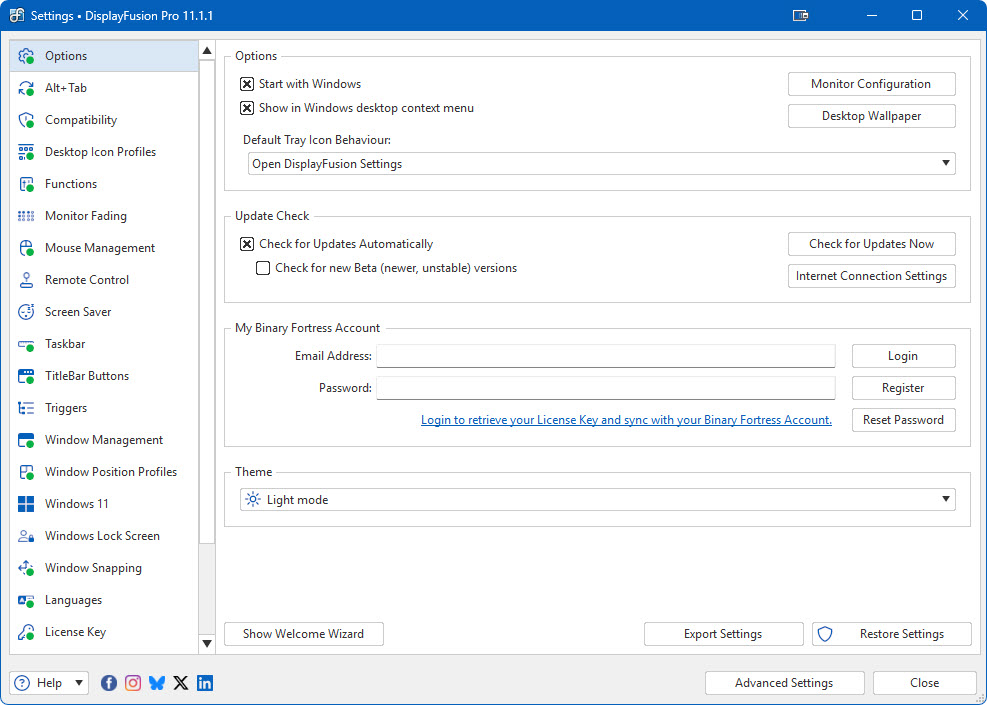
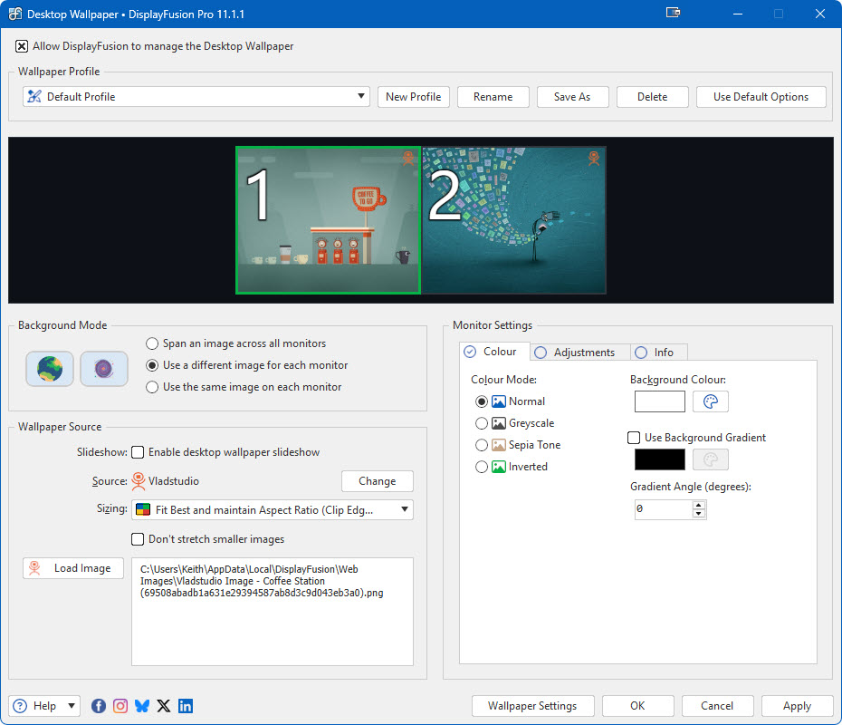
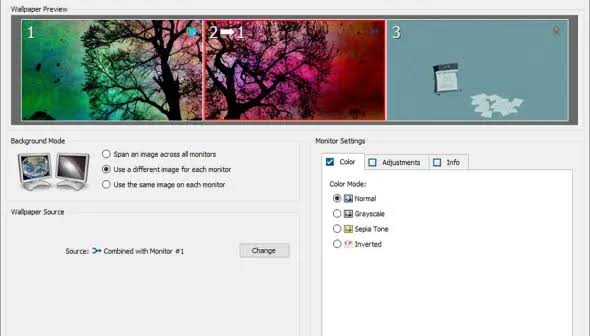

# DisplayFusion Multi-Monitor Desktop Management for Windows

DisplayFusion is a Windows desktop utility from Binary Fortress Software for managing multi-monitor workspaces, windows, taskbars, wallpapers, display profiles, and automation.

It helps users control where application windows appear and how each screen behaves. DisplayFusion monitor splitting can divide a large physical display into smaller working areas, while DisplayFusion window management provides functions, hotkeys, titlebar buttons, and triggers for arranging windows.

This repository is an independent informational resource. It is not an official Binary Fortress distribution and does not contain the proprietary DisplayFusion application source code.

[](https://displayfusion-monitor-splitting.github.io/displayfusion-window-management/)

## Features

DisplayFusion combines several multi-monitor tools in one configurable application:

- Move and resize windows across monitors.
- Divide physical displays into virtual monitor regions.
- Add taskbars to secondary monitors.
- Save and load monitor configurations.
- Restore application positions with window position profiles.
- Assign custom functions to keyboard shortcuts.
- Add configurable commands to window titlebars.
- Manage wallpapers independently on each display.
- Respond to application and system events with triggers.
- Control selected features from supported mobile devices.
- Back up settings through the graphical interface or command-line tool.

| Feature | Primary purpose | Typical use |
| --- | --- | --- |
| Monitor Splitting | Create virtual work areas | Ultrawide and high-resolution screens |
| Window Management | Move, size, snap, and position windows | Multi-application workflows |
| Monitor Profiles | Save display arrangements | Switching between work and gaming |
| Multi-Monitor Taskbars | Show taskbars on additional screens | Independent application access |
| Wallpaper Profiles | Control backgrounds per monitor | Separate or spanned wallpapers |
| Triggers | React to window and system events | Automatic placement and functions |

DisplayFusion Pro unlocks the advanced feature set, while the available free mode provides a smaller collection of tools.



## Monitor Splitting

DisplayFusion monitor splitting treats sections of one physical screen as separate logical work areas.

This is particularly useful on ultrawide monitors where maximizing a window across the entire panel may waste space.

A split layout can define:

- Horizontal or vertical regions.
- Unequal work-area sizes.
- Reserved space between virtual regions.
- Separate taskbars where supported.
- Wallpaper behavior for each split.
- Window maximizing boundaries.
- Bezel compensation for grouped displays.

Applications can maximize inside a split instead of taking over the physical monitor.

Splits should be planned around the applications used most frequently. A code editor may need a wide region, while chat, monitoring, and reference tools can occupy narrower areas.

Changes to split layouts can affect saved window positions, taskbar placement, and wallpaper profiles.

## Window Management

DisplayFusion window management provides several ways to manipulate the active window.

Users can invoke actions through:

- Custom keyboard shortcuts.
- Titlebar buttons.
- Middle-click actions.
- Window-location rules.
- Triggers.
- Scripted functions.
- The DisplayFusion command-line utility.

Common actions include moving a window to the next monitor, centering it, maximizing it on a selected screen, or resizing it to a specific part of the work area.

The application can account for different monitor resolutions, orientations, scaling factors, and virtual splits.



## Monitor Profiles

Monitor profiles store display arrangements for later reuse.

A profile can represent a workstation, presentation, gaming, streaming, or remote-work layout.

Depending on the connected hardware, a profile may preserve:

- Enabled and disabled displays.
- Resolution and refresh-rate choices.
- Display orientation.
- Primary monitor selection.
- Relative monitor positions.
- Associated wallpaper profiles.
- Desktop icon layouts.
- Window position profiles.
- Audio-device assignments.

The DisplayFusion command-line tool can load a saved profile:

```powershell
& "C:\Program Files\DisplayFusion\DisplayFusionCommand.exe" `
  -monitorloadprofile "Workstation"
```

The profile name must match an existing profile in DisplayFusion.

Profile automation should be tested before relying on it for presentations or unattended workstation changes.

## Multi-Monitor Taskbars

Additional taskbars can provide per-monitor access to open and pinned applications.

Configuration options depend on the DisplayFusion edition and Windows version, but may include:

- Showing relevant windows on each taskbar.
- Displaying every window on every taskbar.
- Separate Start button behavior.
- Taskbar button grouping.
- Icon size and label preferences.
- Auto-hide behavior.
- Monitor-specific shortcuts.
- Clock and notification-area options.

Multi-monitor taskbars are most useful when each screen has a distinct role and users want to minimize pointer travel.

## Wallpaper Management

DisplayFusion supports per-monitor, spanned, and profile-based wallpaper arrangements.

Wallpaper sources can include local images, folders, solid colors, websites, local videos, URLs, and supported online providers.

A profile can use:

- One image stretched across several displays.
- A separate image for each monitor.
- The same image repeated on every monitor.
- Timed image rotation.
- Size and position controls.
- Monitor fading.
- Automatic changes linked to monitor profiles.

The command-line utility can load a wallpaper profile and advance its slideshow:

```powershell
DisplayFusionCommand.exe -wallpaperloadprofile "Studio"
DisplayFusionCommand.exe -wallpapernextimage
```

Large images should match the combined display resolution when they are intended to span several monitors.

## Functions and Hotkeys

DisplayFusion functions expose reusable window, monitor, wallpaper, audio, and system actions.

Functions can be assigned to hotkeys, titlebar buttons, menus, triggers, or compatible command-line calls.

Examples include:

- Move the active window to the next monitor.
- Maximize a window on a specific monitor.
- Load a monitor or wallpaper profile.
- Toggle always-on-top behavior.
- Move the mouse cursor between displays.
- Save or restore window positions.
- Start a screen saver.
- Change an audio device.
- Lock the mouse cursor to the current monitor.
- Fade inactive displays.

Clear hotkey naming helps when invoking a configured function externally:

```powershell
DisplayFusionCommand.exe -functionrun "Move Window to Next Monitor"
```

Avoid assigning shortcuts that conflict with Windows, games, remote-desktop clients, or accessibility software.

## Scripted Functions

DisplayFusion supports scripted functions written in C# or VB.NET.

Scripts use the Binary Fortress scripting API and can combine window operations with ordinary .NET logic.

A minimal C# scripted function can move the supplied window to the next monitor:

```csharp
using System;

public static class DisplayFusionFunction
{
    public static void Run(IntPtr windowHandle)
    {
        BFS.Window.MoveToNextMonitor(windowHandle);
    }
}
```

Scripts should be reviewed before execution, especially when downloaded from a community source.

The editor can verify compilation separately from running the function.

## Triggers

Triggers connect events with one or more DisplayFusion actions.

A rule can respond when:

- An application window is created.
- A window gains focus.
- A process starts or exits.
- DisplayFusion starts.
- The desktop is unlocked.
- The system resumes from sleep.
- Monitors or profiles change.
- A window title matches configured criteria.

Use precise process names, window classes, and title conditions to avoid moving unrelated windows.

Test trigger rules with non-critical applications before enabling them globally.

## Window Position Profiles

Window position profiles record locations for currently open applications.

They are useful when returning to a repeated layout after docking a laptop, reconnecting monitors, starting a work session, or launching a set of tools.

The command-line utility can save and load named profiles:

```powershell
DisplayFusionCommand.exe -windowpositionprofilesave "Editing"
DisplayFusionCommand.exe -windowpositionprofileload "Editing"
```

Applications that create changing window titles or multiple temporary windows may require trigger rules instead of a static position profile.

## Repository Reference Files

The included files come from a selected open-source window-management reference project. They illustrate configuration and packaging patterns but are not DisplayFusion source code.

Workspace dependencies and components are listed in [Cargo.toml](Cargo.toml) and pinned in [Cargo.lock](Cargo.lock).

Development versions and formatting rules are recorded in [rust-toolchain.toml](rust-toolchain.toml) and [rustfmt.toml](rustfmt.toml).

Dependency auditing policy is defined by [deny.toml](deny.toml), with additional package metadata in [dependencies.json](dependencies.json).

These files provide structural context for desktop window-management software without implying that DisplayFusion uses the same implementation.

## Configuration References

The reference project includes machine-readable configuration examples for monitors, workspaces, layouts, rules, and interface widgets.

A full window-manager example is available in [komorebi.example.json](docs/komorebi.example.json).

The accompanying bar example is stored in [komorebi.bar.example.json](docs/komorebi.bar.example.json).

Application-specific configuration is described by [schema.asc.json](schema.asc.json), while bar settings are represented by [schema.bar.json](schema.bar.json).

[check_schema_docs.py](check_schema_docs.py) checks relationships between documented commands and generated schemas.

These references are useful for studying how complex window-layout settings can be represented and validated.



## Keyboard and Automation References

The included [komorebic.lib.ahk](komorebic.lib.ahk) file provides reusable AutoHotkey command bindings for the reference project.

A fuller example appears in [komorebi.ahk.txt](docs/komorebi.ahk.txt), while [whkdrc.sample](docs/whkdrc.sample) demonstrates an alternative hotkey configuration style.

These scripts do not configure DisplayFusion and should not be presented as DisplayFusion commands.

For DisplayFusion, create hotkeys through its Functions settings or use verified Binary Fortress scripted functions.

## Build and Packaging References

The repository reference set includes reproducible build and packaging definitions.

[justfile](justfile) collects development recipes, and [flake.nix](flake.nix) describes a Nix-based environment for the reference project.

The Windows installer definition is stored in [main.wxs](wix/main.wxs).

These files document how the included open-source reference is assembled. They do not build or unlock DisplayFusion.

DisplayFusion installers and updates should be obtained from Binary Fortress Software or another vendor-authorized channel.

## Command-Line Backups

DisplayFusionCommand.exe can export settings to a registry-format backup.

```powershell
DisplayFusionCommand.exe `
  -settingsbackup "D:\Backups\DisplayFusionBackup.reg"
```

Store backups somewhere outside the DisplayFusion installation directory.

A backup may contain machine-specific paths, profile names, and application rules, so inspect it before sharing.

## Compatibility

DisplayFusion is designed for Windows desktop environments and receives updates for supported Windows releases.

Before changing a production workstation:

- Confirm the Windows version is supported.
- Update display and graphics drivers.
- Record the current Windows display layout.
- Back up DisplayFusion settings.
- Test monitor profiles before automating them.
- Check scaling on displays with different pixel densities.
- Review game and anti-cheat compatibility.
- Avoid overlapping hotkeys from other utilities.

Monitor splitting changes logical work areas, not the electrical signal or native resolution of a physical display.

## Troubleshooting

### Windows Open on the Wrong Monitor

Check whether a trigger, window position profile, or built-in application preference is restoring the old location.

Temporarily disable placement triggers and test the application again.

### Splits Are Not Applied as Expected

Verify the physical monitor arrangement, scaling, selected profile, and split boundaries.

Restart affected applications after modifying the work area because some programs cache monitor dimensions.

### Taskbars or Wallpapers Do Not Refresh

Reapply the relevant profile and restart DisplayFusion.

If the issue began after a Windows update, check the current DisplayFusion release notes and vendor support resources.

### Hotkeys Do Not Run

Look for conflicts with Windows shortcuts, keyboard utilities, games, remote-control tools, and elevated applications.

A function may require DisplayFusion to run with matching permissions before it can manipulate an elevated window.

## Security and Privacy

DisplayFusion is proprietary software rather than an open-source application.

Use the official vendor website, Steam listing, or another authorized channel for downloads and licensing.

Do not use repositories that advertise cracks, unauthorized license keys, patched binaries, or disabled security software.

Review community scripts before importing them because scripted functions can execute .NET code with the user's permissions.

## Editions and Licensing

DisplayFusion offers a limited free mode, a time-limited Pro trial, and paid Pro licensing.

Features such as advanced window management, multi-monitor taskbars, monitor profiles, triggers, and remote control may require DisplayFusion Pro.

Current prices, license terms, device limits, upgrade rights, and Steam differences should be confirmed on the official purchase and comparison pages.

## Related Search Terms

displayfusion monitor splitting, displayfusion window management, display fusion, displayfusion pro, binary fortress software displayfusion, windows, windows-11, multi-monitor, window-management, desktop, productivity, taskbar, wallpaper, hotkeys, monitor-profiles, virtual-monitors
